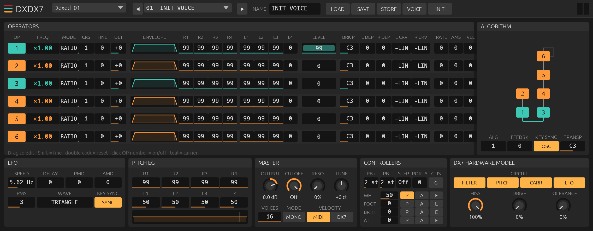

# DXDX7

**A Yamaha DX7 for modern DAWs, by Jardim Sonoro.**

DXDX7 is a free, non-commercial study in hardware simulation: the
[Dexed](https://github.com/asb2m10/dexed) FM engine ported to Rust with the
[truce](https://github.com/truce-audio/truce) plugin framework, plus a model
of what the original DX7 Mark I hardware does to the sound after the FM
chip: its 49.1 kHz clock, carrier scaling, per-voice gain-ranged DAC,
sample-and-hold and analog reconstruction filter. The interface is a
flat, Ableton-style panel with the whole voice on one screen.



- Formats: **AU**, **VST3**, **CLAP** (macOS; builds on Windows/Linux from source)
- Reads and writes DX7 / Dexed SysEx: 32-voice cartridges (VMEM, 4104 bytes) and single voices (VCED)
- The 33 cartridges Dexed ships with (1056 voices) are built in
- Every voice parameter is an automatable host parameter with real units

## Install (macOS)

**Download**: the [latest release](https://github.com/nagualcode/dxdx7/releases/latest)
has the Audio Unit for Apple Silicon. Unzip it, copy `DXDX7.component` to
`~/Library/Audio/Plug-Ins/Components/`, and rescan in Ableton Live:
*Plug-Ins › Audio Units › Jardim Sonoro › DXDX7*. The build is not
notarized; if macOS blocks it, run
`xattr -dr com.apple.quarantine ~/Library/Audio/Plug-Ins/Components/DXDX7.component`.

**From source**:

```sh
cargo install cargo-truce
cargo truce install        # builds and installs AU, VST3 and CLAP
```

Bundles go to `~/Library/Audio/Plug-Ins/{Components,VST3,CLAP}`. Rescan in
Ableton Live: *Plug-Ins › Audio Units › Jardim Sonoro › DXDX7*.

## Using it

### Header

| Control | What it does |
|---|---|
| Cartridge menu | The built-in banks (Dexed_01, SynprezFM_01..32). |
| ◀ program ▶ | Pick one of the cartridge's 32 voices. |
| NAME | The voice name (10 characters, saved with STORE / VOICE). |
| LOAD | Open a `.syx`: a cartridge replaces the bank, a single voice replaces the current voice. Checksum errors and raw (headerless) banks are accepted, as in Dexed. |
| SAVE | Write the current cartridge as a standard DX7 bulk dump. |
| STORE | Write the edited voice into the current cartridge slot. |
| VOICE | Export the current voice as a single-voice SysEx. |
| INIT | DX7 INIT VOICE. |

MIDI program changes pick a voice from the current cartridge, and a
single-voice SysEx dump sent over MIDI is loaded. Pitch bend, mod wheel
(CC1), breath (CC2), foot (CC4), sustain (CC64) and channel pressure work
as on Dexed; their pitch / amp / EG-bias routing is in CONTROLLERS.

### Panel

- **Operators**: one row per operator, OP1 on top. Click the number to
  switch an operator off. Teal = carrier, orange = modulator in the
  current algorithm. Columns: frequency (ratio or fixed Hz), mode,
  coarse, fine, detune; envelope sketch and rates/levels; output level;
  keyboard level scaling (break point, depths, curves); rate scaling, amp
  mod sensitivity and velocity sensitivity.
- **Algorithm**: the operator graph with its feedback loop, drawn from the
  same routing table the engine uses; algorithm, feedback, oscillator key
  sync and transpose below it.
- **LFO**, **Pitch EG**, **Master** (output, Dexed's cutoff / resonance
  filter, tuning, voices, mono, velocity scale) and **Controllers**.
- **DX7 Hardware Model**: switches for the parts of the hardware model
  (FILTER, PITCH, CARR, LFO) and the HISS / DRIVE / TOLERANCE amounts.

Drag to change, Shift-drag for fine steps, double-click to reset, mouse
wheel for single steps.

## Engine

DXDX7 runs one engine, **DX7 Vintage**: Dexed's "Mark I" core (log-sine /
exp tables like the OPS chip) plus the model of the DX7 hardware below,
with the DX7 Mark I gain-ranged DAC.

Two more engines and two more DAC modes are still in the code and reachable
through host automation (parameters *Engine* and *DAC*), but they are not
on the panel. Their UI is commented out in `src/ui/mod.rs` and can be
brought back:

| Hidden option | What it is |
|---|---|
| Engine **Modern** | Dexed's "Modern" core (msfa): high-resolution sine, linear gain, host sample rate. |
| Engine **Mark I** | Dexed's default engine: the Mark I core at the host sample rate, without the hardware model. |
| DAC **Clean** | No converter quantisation. |
| DAC **12-bit flat** | Linear 12-bit without gain ranging; no DX7 did this, it is a lo-fi comparison. |

### The DX7 hardware model

What software usually leaves out, based on die photos of the YM21280 OPS
chip (Ken Shirriff), the VDX7 firmware-level emulator, the annotated v1.8
firmware and Yamaha's patents. Details and sources are in
[`docs/HARDWARE.md`](docs/HARDWARE.md) and the full research notes in
[`docs/RESEARCH.md`](docs/RESEARCH.md).

| Part | Hardware fact | In DXDX7 |
|---|---|---|
| Clock | 9.4265 MHz / 192 = **49,096 Hz** sample rate. FM aliasing folds around 24.55 kHz, so inharmonic alias tones land where they do on the real unit. | The FM core runs at 49,096 Hz and is resampled to the host rate. |
| Carrier scaling (**CARR**) | Each carrier is attenuated by log2(number of carriers) in the log domain (US 4,554,857 "COM"). Six-carrier algorithms are 15.8 dB quieter per carrier, and a carrier's own feedback is weaker (why Dexed's algorithm 32 feedback is "too strong", Dexed #146). | Applied before the exp lookup, exactly where the chip does it. |
| DAC | Each voice is converted on its own: 15-bit value into a 12-bit BA9221 DAC shifted by 0-3 bits, with an analog /1../8 ladder: sign + 11-bit mantissa + 2-bit exponent. The grain rises and falls with each voice's level. | Per voice, then voices summed (as the analog S&H does). Always on. |
| Sample-and-hold | The DAC holds every sample: sin(x)/x droop, -1.4 dB at 15 kHz. | Built into the resampling kernel. |
| Output filter (**FILTER**) | Passive pole + two Sallen-Key stages, 5th order: 6.8 kHz, 11.6 kHz Q 1.02, 16.1 kHz Q 4.13 - flat to 5 kHz, +0.8 dB at 15 kHz, -3 dB at 17 kHz, -14 dB at 20 kHz. | Designed into the resampler's FIR from the analog response, so it is correct at 44.1 and 48 kHz (a bilinear IIR is 8 dB off at 15 kHz there). |
| Tuning (**PITCH**) | Pitch is 1024 steps/octave (1.17 cents). The key code gives 3 semitones per 256 steps, so the 2nd and 3rd semitone of each minor third are 0.39 and 0.78 cents flat. Ratios are rounded log values: x5 is +0.41 cents, x11 is -0.54 cents, so "harmonic" partials slowly beat. | Firmware coarse/fine/fixed tables and the key-code pattern; A4 stays 440 Hz. |
| LFO (**LFO**) | The firmware updates LFO and modulation at ~372 Hz: fast vibrato is audibly stepped. | LFO held for 2 blocks (128 samples) at 49.1 kHz. |
| Hiss | No published measurement; owners describe a noisy output. | Optional, about -84 dBFS (**HISS**); estimate, documented as such. |
| Tolerance | The DAC ladder uses 0.1 % resistors: tiny per-unit gain steps between DAC ranges. | **TOLERANCE** sets per-range gain errors up to about 0.2 % and a fixed per-voice offset up to 1.5 cents. 0 = exact. |
| Drive | - | Optional output op-amp soft clip (0 = off). |

**Not modelled yet** (open questions in the research notes): per-sample
12-bit EGS envelopes (the engine still uses Dexed's 64-sample envelope
blocks), the 32-step velocity quantisation, the one-bit uncertainty of the
feedback shift, detune law, and the multi-operator feedback taps of all 32
algorithms from VDX7's ROM table (algorithms 4 and 6 use Dexed's version).

## Preset compatibility

DXDX7 reads anything Dexed reads: `.syx` cartridges (also with a
performance dump before the voice dump, checksum mismatches, or raw 4096
byte banks) and single voices. Unpacking follows Dexed's
`Cartridge::unpackProgram`, including its rescaling of out-of-range bytes.
Saved banks are standard DX7 bulk dumps that load in Dexed and on the
hardware (through any SysEx tool).

## Build and test

```sh
cargo test --release                              # 17 DSP, SysEx and plugin tests
cargo test --release --features rt-paranoid       # also flags audio-thread allocation
cargo run --release --example render -- 0 13 2 60 out.wav 3   # cart, voice, engine, note
cargo truce validate                              # auval, pluginval, clap-validator
```

Source map: `src/dx7/` - `tables.rs` (sine/exp/log-sine tables), `env.rs`,
`lfo.rs`, `note.rs` (voice, pitch, hardware tuning), `core.rs` (algorithms,
Modern and Mark I kernels, carrier scaling), `synth.rs` (voice allocation,
per-voice DAC), `resample.rs` (49.1 kHz to host, S&H + output filter),
`vintage.rs` (analog stage), `fx.rs` (Dexed's filter). `src/sysex.rs`
(cartridges), `src/params.rs` (generated by `tools/gen_params.py`),
`src/ui/` (editor).

## Credits and license

- FM engine ported from **Dexed** by Pascal Gauthier (GPL-3.0) and **msfa**
  by Raph Levien / Google (Apache-2.0).
- Built-in cartridges: the banks distributed with Dexed (Dexed_01 and
  SynprezFM 01-32).
- Hardware research: Ken Shirriff's YM21280 die analysis, VDX7 by
  chiaccona, the ajxs DX7 firmware disassembly, Raph Levien's MSFA notes,
  Yamaha patents US 4,554,857, 4,249,447, 4,539,883.
- Plugin framework: truce (MIT/Apache-2.0).
- DX7 is a trademark of Yamaha Corporation. DXDX7 is an independent,
  non-commercial project, not affiliated with Yamaha.

DXDX7 is licensed under **GPL-3.0-or-later**.
